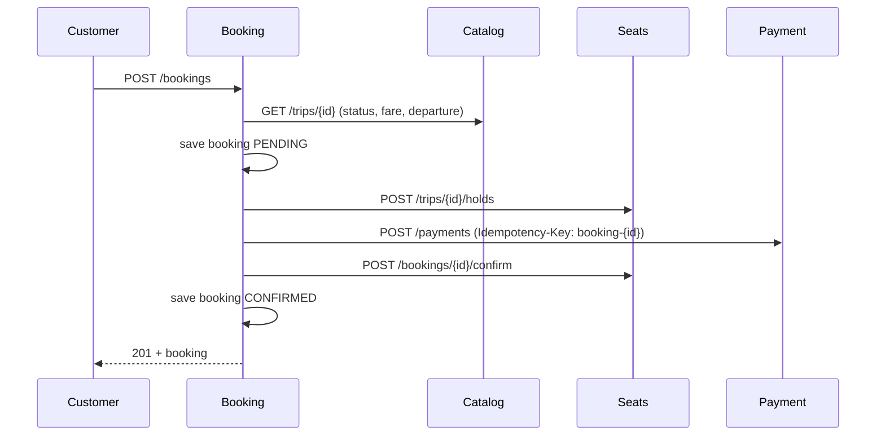

# M3: Booking and Payment

Two new services, and the first place where one customer action touches several services.

| Service | Port | Database | Owns |
|---|---|---|---|
| booking-service | 8083 | `booking` on 15435 | Bookings, and the saga that creates them |
| payment-service | 8084 | `payment` on 15436 | Payment attempts (a mock card gateway) |

Booking calls Catalog (what is this trip, what does it cost), Seats (hold, confirm, release) and Payment (charge).
Nothing calls Booking yet. If a database port does not answer, compare `docker-compose.yml` with the ports above.

## Booking a seat



Every step can fail. What the customer and the data look like afterwards:

| Where it stops | Booking | Seats | Payment | HTTP | `code` |
|---|---|---|---|---|---|
| Bad request (0 or more than 4 seats, bad email, unknown payment method) | none saved | untouched | none | 400 | `INVALID_REQUEST` |
| Trip unknown | none saved | untouched | none | 404 | `TRIP_NOT_FOUND` |
| Trip cancelled | none saved | untouched | none | 409 | `TRIP_NOT_BOOKABLE` |
| Within 30 min of departure | none saved | untouched | none | 409 | `BOOKING_CLOSED` |
| Catalog down | none saved | untouched | none | 503 | `SERVICE_UNAVAILABLE` |
| A seat is taken | FAILED | not held | none | 409 | `SEAT_UNAVAILABLE` (+ `seatNos`) |
| A seat does not exist | FAILED | not held | none | 400 | `UNKNOWN_SEAT` (+ `seatNos`) |
| Seats down or refusing the hold | FAILED | release tried | none | 503 | `SEAT_SERVICE_UNAVAILABLE` |
| Card declined | FAILED | released | DECLINED | 402 | `PAYMENT_DECLINED` |
| Payment down or timed out | FAILED | released | **unknown** | 503 | `PAYMENT_UNAVAILABLE` |
| Paid, then seats could not be confirmed | FAILED, keeps `paymentId` | hold may have expired | SUCCEEDED | 500 | `PAID_BUT_NOT_CONFIRMED` |
| Everything worked | CONFIRMED | SOLD | SUCCEEDED | 201 | none |

Errors after the booking was saved carry its `bookingId`, so the customer can quote it and `GET /bookings/{id}` shows the FAILED row.

## Booking API (8083)

| Call | Meaning |
|---|---|
| `POST /bookings` | Body: `{tripId, seatNos[1..4], customerName, customerEmail, paymentMethod}`. `paymentMethod` is `mock-ok` (default) or `mock-decline`. 201 with the booking, or an error from the table above. |
| `GET /bookings/{id}` | One booking. 404 `BOOKING_NOT_FOUND`. |
| `GET /bookings/by-reference/{ref}` | Same, by the short code the customer sees (`KP-7H3K9QWM`). Case-insensitive. |

A booking: `id, reference, tripId, status (PENDING|CONFIRMED|FAILED), failureReason, seatNos, fareYen, totalYen, currency, customerName, customerEmail, departureAt (Asia/Tokyo), paymentId, createdAt`.
The fare is copied from the trip when booked, so a later fare change never alters an old booking.

## Payment API (8084)

| Call | Meaning |
|---|---|
| `POST /payments` + header `Idempotency-Key` | Body: `{bookingId, amountYen, method}`. 201 for a new payment, **200 with header `Idempotent-Replayed: true`** when the key was seen before (same answer as the first time). A declined card is a normal answer: `status: DECLINED` in the body, not an HTTP error. |
| `GET /payments/{id}` | One payment. 404 `PAYMENT_NOT_FOUND`. |

Errors: 400 `INVALID_REQUEST`, 422 `IDEMPOTENCY_KEY_REUSED` (same key, different booking/amount/method).
The mock gateway: `mock-ok` succeeds, `mock-decline` is declined with `CARD_DECLINED`.

Try the idempotency by hand (run it twice and compare the status codes, 201 then 200):

```bash
curl -i -X POST localhost:8084/payments -H 'Content-Type: application/json' \
  -H 'Idempotency-Key: demo-1' \
  -d '{"bookingId":"11111111-1111-1111-1111-111111111111","amountYen":4500,"method":"mock-ok"}'
```

## Design decisions

- **The saga is not one database transaction.** The three services have three databases, so there is nothing to roll back across them. Each step is saved on its own, and a failure runs an explicit undo (release the seats). `BookingService` is deliberately not `@Transactional`, so no database connection is held while waiting on another service.
- **Payment can never charge twice.** The key is `booking-{bookingId}`, fixed per booking, and `payments.idempotency_key` is UNIQUE. The insert is `INSERT ... ON CONFLICT DO NOTHING`, so two requests arriving together are settled by the database, not by application code. Checked with 50 simultaneous inserts of one key: exactly one wins.
- **Impossible states are rejected by the database.** CHECK constraints: a PENDING booking has no reason and no payment, a CONFIRMED one has a payment and no reason, a FAILED one has a reason, `total = fare x seats`, 1 to 4 seats. The entity also refuses any move except PENDING to CONFIRMED or PENDING to FAILED. `@Version` makes a stale concurrent update fail instead of silently overwriting.
- **Failed attempts are kept.** A refused booking is a row with `status = FAILED` and a reason. That is the audit trail, and in M4 the place to find "paid but not confirmed" cases.
- **Gateways are interfaces.** `CatalogGateway`, `SeatsGateway`, `PaymentGateway` hide HTTP from the saga, so `BookingServiceTest` runs the whole saga with hand-written fakes: no Spring, no network.
- **Validation happens first.** Even the payment method is checked before anything is saved, so a typo cannot surface half way through a saga.

## Known gaps (on purpose, for later milestones)

| Gap | What happens today | Planned |
|---|---|---|
| Refund for `PAID_BUT_NOT_CONFIRMED` | Booking is FAILED with the `paymentId`; nobody refunds it | M4 |
| Unknown payment outcome (`PAYMENT_UNAVAILABLE`) | Seats are released; the customer may have been charged. Retrying the charge with the same key is safe, but nothing retries yet | M4 |
| A crash mid-saga | The booking stays PENDING; its hold expires after 10 minutes | M4 sweeper for stale PENDING |
| Client double-click | Two `POST /bookings` create two bookings; the second gets a seat conflict. No client-supplied idempotency key yet | M4 |
| No HTTP timeouts or retries on the three clients | A hung downstream holds a request thread | M6 |
| Hold expiring during payment | Handled as `PAID_BUT_NOT_CONFIRMED` | M4 |

## Running it

1. `docker compose up -d`
2. Start catalog (8081), seat (8082), payment (8084), booking (8083). In IntelliJ or `./mvnw spring-boot:run` inside each service folder.
3. Once, if there are no trips yet: `curl -X POST 'localhost:8081/admin/trips/generate?days=14'`
4. `scripts/booking-demo.sh` walks the happy path, a seat conflict, a declined card and the refused requests, and prints PASS or FAIL for each.
5. `scripts/parallel-booking-test.sh`: 50 customers book one seat at once; exactly one is CONFIRMED, 49 get 409.

New repo? Run `scripts/bootstrap-m3-services.sh` once after unzipping. It copies the build files from catalog-service and registers both modules.

## What was and was not tested

Tested: the saga logic (17 scenarios with fakes), the validation rules, the booking-reference format, the mock gateway, both SQL migrations on a real PostgreSQL, and the one-winner guarantee of the idempotent insert under 50 parallel connections. The two scripts were run against a stand-in server for the four services.

**Not run yet: the services themselves.** Spring wiring, the Hibernate mapping against the schema (`ddl-auto: validate`) and the three REST gateways have only been compiled. Your first run is their first real test. If a service refuses to start, the message names the column or bean at fault.
